# H.A.V.O.C.

**Heavy Assault Vessel: Orbital Combat**

Your ship is an unreasonable amount of firepower with a cockpit attached!

Fly an original polygon rail shooter for the **64 MHz C64 Ultimate**. Skim green hills, squeeze through crystal caves, defeat an enemy carrier, then climb into orbit. Cross asteroid fields, a shattered moon, abandoned fleets and orbital shipyards before confronting a dreadnought and the Jump Gate. Everything is drawn in the C64's sixteen colors, backed by an original stereo SID soundtrack.

## See it in action

**Sound on!** Hear the enhanced four-SID score and the game's own weapon, engine, and impact effects. This 72-second trailer shows the current compiled C64 build with its renderer and music improvements, recorded in a calibrated PAL emulator at the game's original speed. Fly through four terrestrial missions, climb into orbit, and get a brief peek at the Asteroid Belt, without revealing bosses or the ending.

https://github.com/user-attachments/assets/f2c0d2a9-250d-456e-89e2-7e5f1bc5605a

The current source campaign has eighteen stages and five bosses, with 24:46 of scheduled flight before retries or extended boss fights. The original twelve stages lead into six orbital missions, each with its own enemy silhouettes and scenery. The orbital score adds eight original, Jeroen Tel-inspired SID tracks, and every track now brings its own tiny "music kernel": per-song 6502 code swapped in from the REU that sweeps the filter, shimmers pulse widths, bends and slurs the lead, flutters arpeggios and programs the drums between the sequencer's rows. The four-SID build also answers the lead with a stereo echo from the opposite chip and rings bells and anvils on the extra SIDs. Steering and weapons stay the same in space: shoot the small fragments, use bombs to clear large rocks and wreckage, and attack the bosses' side units before their cores. Brief scenic crossings include the climb out of the atmosphere.

| Lowland Approach | Crystal Cave |
| --- | --- |
| 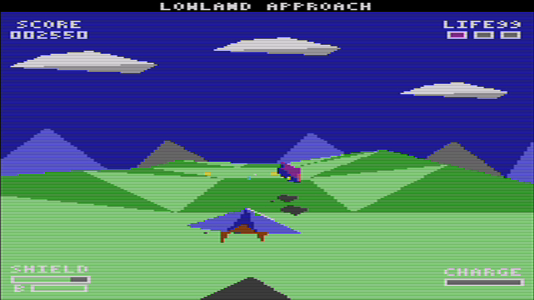 | 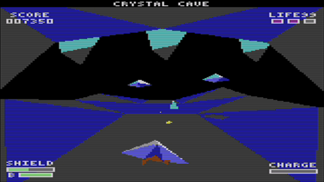 |
| **Iron Canyon** | **Foundry Belt** |
| 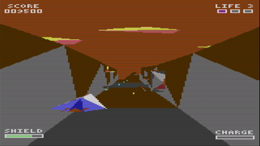 | 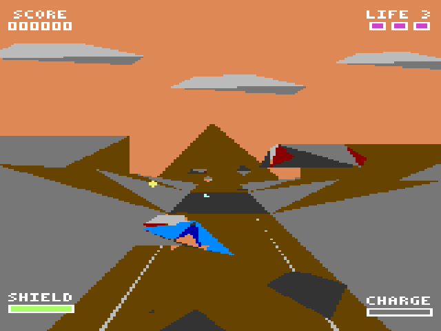 |
| **Storm Front** | **Carrier Assault** |
| 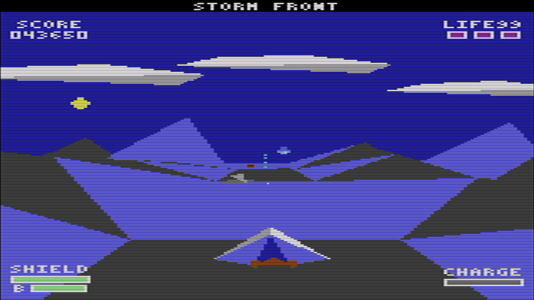 | 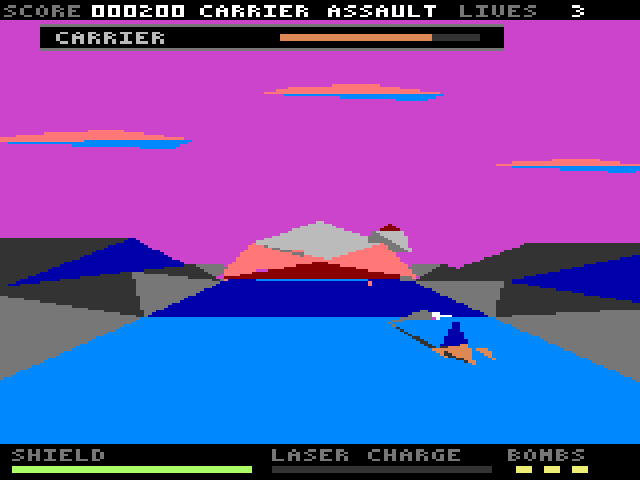 |
| **Asteroid Belt** | **Shattered Moon** |
| 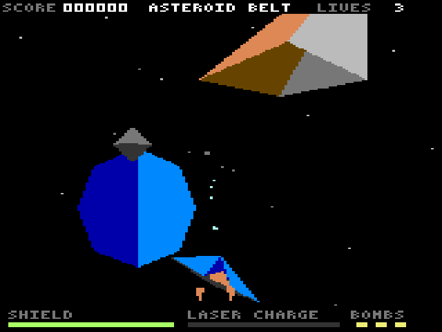 | 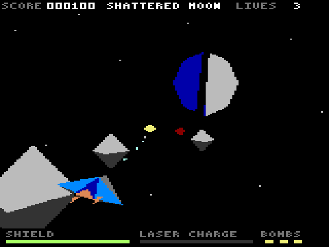 |
| **Ship Graveyard** | **Orbital Shipyard** |
| 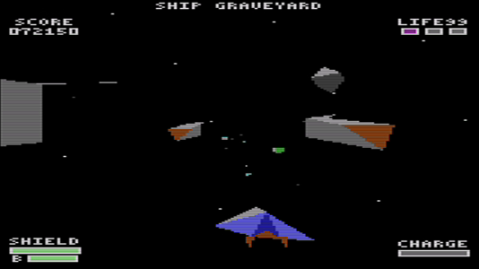 | 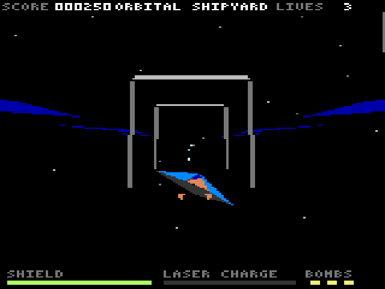 |
| **Space Carrier** | **Jump Gate** |
| 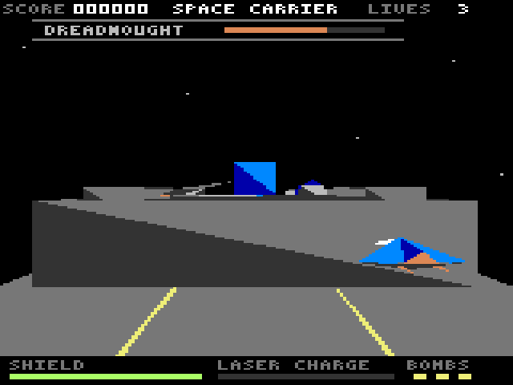 | 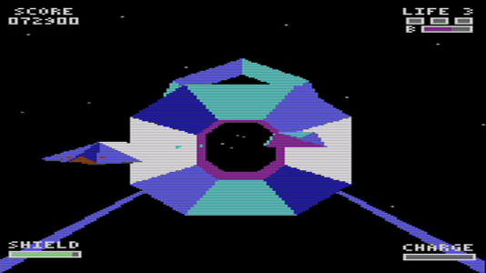 |

## Download and launch

**H.A.V.O.C. v0.1.0** includes the complete eighteen-stage campaign. Choose the package that matches your sound hardware:

- **[Download the standard two-SID package](https://github.com/fechols/havoc64u/releases/download/v0.1.0/havoc-v0.1.0-2sid.zip)** — uses the Ultimate's two built-in UltiSIDs. No physical SID chips are required.
- **[Download the enhanced four-SID package](https://github.com/fechols/havoc64u/releases/download/v0.1.0/havoc-v0.1.0-4sid.zip)** — adds two physical ARMSIDs for a fuller musical arrangement. Set both ARMSIDs to **8580 behavior** separately.

Both sound profiles use the same eighteen missions and effects. Each ZIP contains the matching `havoc.cfg`, `havoc.reu`, and `havoc.prg`, plus launch instructions and the license. There is no in-game sound-profile switch. See the [release notes](https://github.com/fechols/havoc64u/releases/tag/v0.1.0) for changes and download checksums.

You need a **C64 Ultimate running at 64 MHz**, **1 MiB of REU memory**, and a joystick connected to **port 2**. The supplied configuration sets the speed, REU, and SID routing. The game requires the Ultimate's capabilities; a stock C64 cannot run it.

1. Unzip one package and copy its three files — `havoc.cfg`, `havoc.reu`, and `havoc.prg` — to the Ultimate's storage.
2. Import `havoc.cfg`.
3. Load `havoc.reu` into the REU at **address zero**.
4. Run `havoc.prg`, then press fire to launch.

Keep all three files from the **same package and version** together. If startup reports a mismatch or invalid REU data, reload the matching REU at zero before running the PRG again. Once loaded, the game needs no further disk reads. During play, it only reads from the REU; game state stays in C64 RAM.

**Turn your joystick's hardware autofire off.** The game supplies its own autofire; controller-generated fire pulses can accidentally spend your bombs.

## Fly, fire, survive

Your ship flies forward automatically. You steer around enemies, incoming shots, and scenery.

| Input | Action |
| --- | --- |
| Left / right | Move sideways |
| Up / down | Climb / dive |
| Hold fire | Fire continuously |
| Release fire, then press again | Fire a charged shot; charging starts after one second |
| Release fire for two seconds, then press | Launch a homing missile |
| Double-tap fire within half a second | Spend one bomb, as well as firing normally |
| Double-tap left or right within half a second | Barrel roll and dodge in that direction |
| Fire at the title or after a run | Start a new game |
| Space bar | Pause and resume the flight |
| F | Toggle the frame-rate readout at the top right |

Watch the weapon meter: when it reads **HOMING MISSILE**, your next shot will lock onto a random target ahead. It keeps tracking that target until it is destroyed or passed, then chooses another. Partial charges produce stronger straight shots.

- **Roll through enemy fire.** Rolls deflect hostile shots, and you can keep steering and firing. Solid scenery can still hurt you; small orbital fragments can be destroyed.
- **Fly it like an aircraft.** The stick commands where the ship goes, not where it is: the hull gathers speed over a quarter of a second, banks into a turn and levels out as it slides, banks the other way as it brakes, raises or lowers its nose as you climb or dive, and eases into the edges of the lane instead of hitting a wall. A roll adds a sideways push that carries on for a moment after the spin, so hold the stick the same way for the quickest dodge.
- **Watch them fly past.** Enemies and hazards you dodge no longer blink out in front of you; they fly on past the cockpit and out of view. Bosses stay full size, while regular enemies are a quarter smaller than before.
- **Feel the hits.** Taking damage gives the picture a short two-pixel jolt and a red border flash; bombs keep their bigger shake.
- **The sky moves with you.** Clouds, horizons and the orbital starfield drift slightly against your steering, a little more for the nearer clouds than for the horizon.
- **Use your bombs.** Every five enemy kills restore one, up to a maximum of three. Bombs also destroy large orbital rock and wreckage hazards.
- **Collect supplies.** Shield and bomb pickups pull toward you when nearby. The green shield and the yellow rectangle match their HUD gauges. Shield drops are eligible every eight enemy kills and restore 60 points, up to 100.
- **Aim for the boss's side units first.** Destroy both to expose its core. Bosses now have twice their previous health; each defeat immediately restores full shields and three bombs. You must defeat the boss before its stage can end.
- **Make each life count.** You start with three. Losing one returns you to the current stage's checkpoint with your score intact; losing all three ends the run.
- **Catch your breath between stages.** Scenic crossings are safe, but bombs still consume inventory. Leaving a cleared boss stage adds one life, up to three.

Leave the title idle for fifteen seconds to watch the automatic scenery previews and hear the music. Move or press fire to return to the title, then release and press fire again to start. After a run, release any held fire button before restarting, too.

## Current status

**An earlier twelve-stage build completed a successful playthrough on real C64 Ultimate hardware.** A later 1 MiB build was reported to look and sound great on hardware; its sound profile, video standard, and campaign coverage were not specified.

An eighteen-stage orbital build also completed continuous emulator playthroughs with two SIDs on PAL and four SIDs on NTSC, including all five bosses and the final victory reveal. The four-SID run also exercised a natural death and checkpoint respawn. These emulator playthroughs preceded the latest loading optimizations; the [hardware guide](docs/hardware.md#build-and-verification) records their exact build provenance. The renderer's hot paths have since moved to hand-written 6502 assembly behind the Rust reference: the fixed emulator matrix's frame work fell from 120 to 50 ms, with every frame decoded pixel-identical to the Rust renderer. These emulator work-time measurements are not physical-machine frame-rate measurements. Music and sound effects continue independently of the picture. The [v0.1.0 release notes](https://github.com/fechols/havoc64u/releases/tag/v0.1.0) describe validation of the downloadable binaries separately from these earlier playthroughs.

For sound setup, troubleshooting, or building from source, see the [hardware and build guide](docs/hardware.md). Developers can also read the [performance measurements](docs/benchmarks.md). Found a problem? [Open an issue](https://github.com/fechols/havoc64u/issues) with your hardware, sound profile, and what happened.

## License

H.A.V.O.C. is released under the [MIT License](LICENSE). The license covers the whole repository: the game and tool source code, the authored models and encounters, the original SID score, and the images in `docs/media`.
