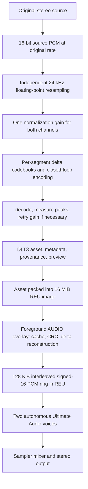

# Current development status: DLT4

The working tree implements the expanded digital soundtrack, Story mode, and the assembly effects revision (package v16). Effects retain their 50 Hz clock and use at most one SID per channel; cannon and impact bodies are brighter while bombs keep their deep foundation. Outgoing DAC music fades for about one second before a new song starts. **The DLT3 document below is a preserved historical snapshot, not the current format or runtime specification.** Its release measurements do not establish DLT4 performance or sound quality, and earlier DLT4 measurements do not certify the current effects or handoff behavior.

| Use | Stored stream | Sampler output |
|---|---|---|
| Hammond Rocker and Galactic Dash | 20 kHz, independent 3-bit codes for each stereo channel | Rounded signed 8-bit true stereo |
| Gameplay | 16 kHz, 3-bit mono | Rounded signed 8-bit mono, with the right output delayed 160 samples (10 ms) |

The [catalog](../assets/music/catalog.json) contains **nine original recordings composed for H.A.V.O.C. by William Echols**, plus a temporary mono Galactic Dash fixture. Hammond Rocker and Galactic Dash retain the stereo title/victory roles. Seven mono recordings match the first seven stages: Lowland Approach, Crystal Cave, Iron Canyon, Canyon Gate, Ashen Wastes, Foundry Belt, and Fortress Run. Later stages retain the mono fixture until their recordings are supplied. The checked `DMC1` version 2 directory includes an explicit eighteen-stage map as well as the semantic cue map, so stages with shared SID cues can select different recordings.

The supplied source recordings and encoded versions carry [William Echols's MIT license](../assets/music/LICENSE); player archives include it as `MUSIC-LICENSE.txt` alongside the game's existing license. See the [catalog authoring notes](../assets/music/README.md) for the current mapping and asset inventory. The original capacity projection for two stereo songs plus 27 minutes of mono music left about 119 KiB for catalog and alignment in the 15,597,568-byte region. That was a planning estimate; final capacity follows the actual recordings, track count, and encoded extents checked by the packer.

The ten-asset catalog currently occupies **10,297,186 bytes**, including its 224-byte directory and alignment, leaving **5,300,382 bytes** free. The seven stage recordings total 10:27.1745 of music; the nine unique recordings total 16:30.6545. The mono Galactic Dash fixture is a stored duplicate and is excluded from that unique duration. DAC state, including the handoff fade, remains within the 432-byte reservation at `$CE00`; effects use 200 bytes within a separate 256-byte reservation at `$CD00`. The matching ELF and memory map supply current state and overlay sizes. The SID soundtrack and music kernels are removed. Startup iterates track IDs without placing a growing track-list copy in resident constant RAM.

The implementation and checks are in:

- [Shared DLT4 format and catalog](../src/digital.rs), [generated descriptors](../src/digital_catalog.rs), and [encoder instructions](../tools/encode-digital-music/README.md). Predictors retain signed-16 precision; only the published PCM is rounded to signed 8-bit. Codes form one continuous least-significant-bit-first stream, and cumulative CRC-8 checkpoints cover every 1,024 compressed bytes.
- [Foreground player](../target-c64/src/digital.rs) and [6502 decoding kernel](../target-c64/asm/digital.S). Two independent decoder contexts use two 64 KiB REU slots. Stereo occupies a complete slot; mono uses its upper 32 KiB, preceded by a cleared 160-byte delay prefix. The sampler's right start and repeat offsets supply the delay without duplicating the PCM.
- [Target integration](../target-c64/src/main.rs) and [separate effects engine](../src/audio.rs), whose 50 Hz tick runs natively as the assembly kernel [`fast_effects_tick`](../target-c64/asm/sfx.S) held to the Rust reference by [`tools/test-sfx-kernel.py`](../tools/test-sfx-kernel.py). The 50 Hz IRQ drives the four-chip pool independently of foreground DAC playback. Effects use one directional chip or one stereo pair, leaving other chips available for overlap. Thirteen shared programs add independent pitch/PWM movement, staged waveform, sync, ring-modulation and resonance changes, gate retriggers and arpeggio/octave/vibrato accents; patches author per-voice pulse widths, eight-bit cutoff envelopes with a rate, and a master-volume punch. The 764-byte resident bank uses 24 PAL/NTSC pitch slots, 21 25-byte patches and thirteen eleven-byte programs. Startup validates the bank, digital catalog and track metadata, clears the sampler's retained low sample bytes with muted signed-16 playback, and caches calibration for both rates.
- [Backend model tests](../tests/digital_backend.rs), [effects tests](../tests/quad_audio.rs), and [linked native-player harness](../tools/test-digital-kernel.py). The host model covers complete loops, delayed mono, both ring slots, queued cancellation/replacement, scratch reuse, corruption and underrun muting. Native timing reports and physical Ultimate listening are separate acceptance steps.

During a change of song, the current track keeps playing while the inactive slot is primed. Each AUDIO visit services the active stream first. Both streams share a decode allowance of 250 ms of PCM (4,000 mono or 5,000 stereo frames); remaining duration is converted between rates for mixed-profile handoffs. Initial loading also primes the ring over bounded AUDIO visits, keeping both sampler gates off until the complete ring is ready. Once the pending ring is ready, a roughly one-second fade starts: foreground service uses the existing CIA timer to lower both sampler voices through 32 equal hardware-volume steps from 32 to zero. This adds neither PCM gain processing nor IRQ work, and songs never crossfade. Handoff waits until the old track is silent and the pending ring is complete, then selects the new ring under a short interrupt mask and starts it at full volume. Repeating the same pending request preserves progress; replacing that request restarts preparation but preserves an active fade, so a late replacement can leave the old track muted until ready. Requesting the active song cancels the pending change and restores its full volume without restarting it.

Ordinary laser hits on indestructible actors emit an impact cue. Enemy/boss damage has priority 4 and player-hit/low-shield feedback priority 5, above scenery and ordinary weapons. Every effect, including bombs, boss explosions and player death, uses at most one SID per channel. A bomb leaves a left chip and a right chip available for ship explosions and other feedback; repeating it restarts its existing pair. Its original core pair's synthesis is preserved, while removal of the doubled pair deliberately changes the combined sound. Physical backup-chip choice does not change program, detune or modulation identity. Spatial events sample source X/depth at trigger time, with a center dead zone of ±4 logical pixels (5% of the screen). Visible scenic sources follow the same rule; ascent/orbital ambience retains authored pans. The configuration stays at `Left 1` / `Right 1` with unchanged gains. See the [effects architecture](hardware.md#quad-sid-effects) for allocation and validation details.

The encoder emits reference and decoded WAVs, including the delayed mono output, for matched-level listening. Profile-specific SNR excludes the bandwidth and stereo information removed by resampling/downmixing. Neither the model checks nor an SNR number establish perceived quality, sustained hardware throughput, or final mixer balance.

The merged Story/graphics/audio build retains all ten catalog assets, including Fortress Run at stage index 6. Initial priming also obeys the shared 250 ms decoded-audio limit: it fills the initial ring across foreground visits before enabling either sampler. The merged native report (`target/merge-validation/digital-report.json`) passes 160 assembly cases, all ten tracks and eleven handoffs per video standard; tested fades last 1.001-1.067 seconds. Stereo startup takes seven bounded service visits and mono takes nine. See the [merged-build validation](hardware.md#quad-sid-effects) for the current package and checks; the older reports below remain historical.

**Pre-merge assembly-effects validation:** the host suite passes (one fixture-export test ignored), and 6,932 native SFX cases per standard match the authored assembly-effects reference's complete state and ordered SID writes through the assembly kernel. The modeled worst-case effects tick is about 0.48 ms PAL / 0.46 ms NTSC, half the compiled v16 engine's, and the interrupt wrapper no longer backs up compiler static frames. IRQ entry/exit is measured separately; these model figures are not physical FPS. The emulator excludes Ultimate DAC playback; see the [current audio validation notes](hardware.md#quad-sid-effects) for scope and the physical comparison procedure.

**Historical v16 validation:** 421 host tests passed, and 6,932 native SFX cases per standard preserved the pitch-only reference's complete state and ordered SID writes. Thirty-second native workloads showed about 15% less worker CPU time for directional combat and 10% less for centered bursts after optimization. All 120 PAL/NTSC audition clips passed without clipping (`target/bright-sfx-comparison.json`, `target/bright-audition-comparison.json`). The final sustained frame comparison passed all thirty matched phase pairs across five workloads and both standards: every median and p95 increase was below 1%, and dense-combat medians improved 0.6953% PAL and 0.1345% NTSC (`target/bright-performance.json`).

The historical v16 DAC report (`target/bright-digital/report.json`) checked 1,183,703 PAL and 1,178,223 NTSC decoded frames across all nine tracks and ten handoffs per standard. Fade durations are 1.007-1.073 seconds at the tested service cadences; active and pending decoding together never exceed 250 ms per frame. Buffer readiness, paired gain steps, cancellation/replacement, clock wrap/rebasing, effects coexistence, corruption and fatal muting all pass. Final memory audits pass 154 layout and 84 overlay rejection fixtures.

**Historical v15 validation:** 419 host tests pass (one fixture-export test ignored), alongside 2,432 exact host/native effects tick comparisons per PAL/NTSC standard. The original bomb's logical core pair is preserved. All ten matched nine-sample effects benchmarks pass the 1% incremental frame-time limit; the largest increase is **0.4357%**, with identical gameplay and rendering results (`target/stereo-performance.json`). Each sample ends after one frame, before later scheduled events; this does not establish sustained-combat behavior. This effects-only comparison excludes DAC service and physical Ultimate timing. The unchanged synthesis bank passed 72 PAL and 33 focused NTSC auditions without clipping; their frozen package and reports are retained under `target/stereo-audition-package` and `target/stereo-auditions{,-ntsc}`.

The matching production DAC report (`target/stereo-digital/report.json`) passes all nine tracks, ten handoffs per standard, cancellation/replacement, clock wrap/rebasing, effects coexistence, corruption and fatal muting. It checks 1,184,599 PAL and 1,178,607 NTSC decoded frames. Fades last 1.006-1.073 seconds at the tested service cadences; the new ring is complete before the zero-volume handoff, and active plus pending decoding stays within 250 ms of PCM per gameplay frame. Final memory audits pass 154 layout and 84 overlay rejection fixtures, with artifact hashes recorded in `target/stereo-final-artifact-audit.json`.

**Historical v14 validation:** native DAC checks passed on PAL and NTSC, including all tracks, handoffs with effects active, corruption and fatal muting (`target/synth-digital/report.json`). The matched nine-sample effects-only emulator benchmarks also passed: the largest frame-time increase was 0.0090% across ten PAL/NTSC scenarios (`target/synth-performance.json`). These reports precede v15's two-SID limit, retuned sounds, spatial routing and outgoing DAC fade; they are not current validation, an absolute audio-CPU budget or a physical-machine measurement. Effects and digital tests derive state offsets from target DWARF. SFX auditions wait 400 ms after recording starts, measure the actual attack against a quiet lead-in, and reject clipping. Optional `--music-dlt` mixes use decoded DLT music and the mono right-channel delay at explicit uncalibrated listening gains; they do not simulate the physical Ultimate mixer.

**Historical nine-asset DLT4 baseline, before the v14 SFX revision:** the build with ELF SHA-256 beginning `d1b2b15267859594` passed the full PAL and NTSC native suites: 160 assembly cases, all nine tracks, ten handoffs, Canyon Gate boss continuity, shared-cue stage changes, protected cues, fallback, 23 ring wraps, and ten corruption cases per standard. Reports are `target/digital-kernel/six-tracks-{pal,ntsc}.json`. The six stage tracks used 71.17–71.47 ms of modeled service per audio second on PAL and 68.57–68.82 ms on NTSC; stereo used 159.22–159.57 / 153.43–153.78 ms respectively. All 137 VICE package-corruption cases also passed (`target/six-tracks-corrupt/summary.json`). Subsequent hardware feedback reported music below the SID effects; the configuration raised both sampler mixer channels from 0 to +6 dB without changing that build's PRG/REU bytes. Those gains remain in the current configuration. These historical timing and PCM checks do not validate v14 or measure the final analog/HDMI mix.

**Historical three-asset DLT4 measurement, before the six stage recordings:** the optimized build passed 160 directed assembly decoder cases and the complete linked-player suite on PAL and NTSC. Its native model includes a CPU at 64 times the bus clock, DMA at one byte per bus tick, and the sampler at `6,250,000 / (divider + 2)` Hz. Steady service excludes startup primes, track preparation/handoffs and fatal calls:

| Profile | PAL service time per audio second | NTSC service time per audio second |
|---|---:|---:|
| Previous 24 kHz stereo player, normalized to nominal rate | 479.8 ms | 462.5 ms |
| DLT4 title stereo | 158.6 ms | 152.9 ms |
| DLT4 victory stereo | 159.0 ms | 153.2 ms |
| DLT4 mono fixture | 70.8 ms | 68.2 ms |

That build achieved approximately **3× faster stereo servicing**, exceeding the 2× target in this model. This is not a whole-game frame-rate or physical-hardware measurement, and these reports predate the nine-asset catalog and stage mapping. The measured ELF SHA-256 begins `11c765121794d497`; reports are `target/digital-kernel/dlt4-{pal,ntsc}-optimized.json`, with the prior build under `target/digital-baseline/`. Its AUDIO image was 14,663 bytes, and music plus effects state used 418 of the reserved 432 bytes. Run `python3 tools/test-digital-kernel.py` for current native checks; its report includes calibrated rates, per-track steady aggregates, PCM checks, handoffs, effects continuity, ring wraps and fault cases. Current-build measurements and physical Ultimate listening remain separate acceptance steps.

---

# H.A.V.O.C. digital music: compression and real-time playback handoff

This document specifies the existing digital music technology closely enough to implement a compatible decoder, reconstruct the encoder's decisions, and evaluate changes against the game's actual constraints. It covers the stereo recordings, DLT3 compression, the C64 foreground player, REU buffering, and Ultimate Audio output. The separate SID music system is outside its scope.

**Snapshot:** 2026-10-23; repository base `c07d99f2cabb35f7bfb60bdaafb3a17619a34351` (`Release v0.1.2 with stereo rock music`), inspected with ongoing, uncommitted renderer/game changes. Source behavior is described from the inspected working tree. Generated package sizes and historical measurements are identified separately; a Git revision alone does not identify those binaries. This document changes no codec, asset, API, or game behavior.

The central design is a division of labor: expensive audio analysis happens offline; the C64 reconstructs each channel with a lookup and a saturating addition; the hardware sampler consumes an already-decoded PCM ring independently of the CPU. Correct playback depends on the foreground returning often enough and producing audio faster than the sampler consumes it. A large ring accommodates individual slow frames, but cannot compensate for inadequate sustained decoding throughput.

## Contents

- [System overview and units](#system-overview-and-units)
- [Offline compression: from source audio to DLT3](#offline-compression-from-source-audio-to-dlt3)
- [Codebook construction and closed-loop encoding](#codebook-construction-and-closed-loop-encoding)
- [DLT3 asset format and integrity](#dlt3-asset-format-and-integrity)
- [Runtime architecture and ownership](#runtime-architecture-and-ownership)
- [Memory and transport blueprint](#memory-and-transport-blueprint)
- [Exact decoding and service behavior](#exact-decoding-and-service-behavior)
- [Initialization, sample clock, and calibration](#initialization-sample-clock-and-calibration)
- [Sampler register contract](#sampler-register-contract)
- [Quantitative real-time envelope](#quantitative-real-time-envelope)
- [Faults and diagnostics](#faults-and-diagnostics)
- [Improvement experiments and the constraints they must preserve](#improvement-experiments-and-the-constraints-they-must-preserve)
- [Reproduction, evidence and verification appendix](#reproduction-evidence-and-verification-appendix)

## System overview and units

### What runs where

The shipping format is **DLT3**, a stereo extension of a DLT2 scalar delta quantizer. Each stereo frame takes one compressed byte: a four-bit left code and a four-bit right code. Each code selects a signed delta from a segment-specific codebook. Each channel has its own codebook and reconstructed previous sample. The two channels share segmentation, stream transport, CRC state, buffering, and clock accounting.

This is lossy predictive coding. Codebooks are learned offline and replaced at predetermined segment boundaries. There is no runtime step-size adaptation, entropy decoder, transform decoder, or cross-channel prediction. Familiar ADPCM terminology is useful background, but a standard IMA ADPCM decoder cannot decode these files.



The source-to-asset operations are host work. Playback uses the checked-in compressed assets and does not require FFmpeg, source MP3s, floating-point arithmetic, Lloyd training, or source-signal analysis on the C64. The target decoder is compiled Rust in an overlay, not a per-sample interrupt routine or a handwritten assembly decoder.

### Units and notation

| Term or symbol | Meaning in this document |
|---|---|
| Channel sample | One signed amplitude for one channel at one instant. |
| Stereo frame | One left sample plus one right sample. Most source identifiers named `samples` count these frames. |
| `f` | Playback rate in stereo frames/s; nominally 24,000. Use the calibrated actual rate for precise deadlines. |
| `N` | Stereo frames in a song; also the compressed stream's byte count in shipping DLT3. |
| `K` | Codebook entries per channel, 16. |
| `C_books` | Pairs of segment codebooks, 521 in each shipping asset. |
| `S` | Regular segment length in stereo frames; the last segment absorbs the remainder. |
| PCM | Decoded signed 16-bit little-endian samples ordered `L0, R0, L1, R1, ...`; four bytes per stereo frame. |
| `R` | Ring capacity, 32,768 stereo frames, equivalent to 131,072 bytes. |
| `G` | Reader/writer guard, 2,048 stereo frames. |
| `B` | Maximum decode batch, 128 stereo frames or 512 PCM bytes. |
| `P`, `C`, `L` | Cumulative frames produced, estimated frames consumed, and lead `L = P - C`. Here `C` is a counter, not codebook count. |
| CPU cycle | A modeled 6502 instruction cycle; converting it to real time requires an explicit CPU timing model. |
| Bus tick | A CIA/bus-clock time unit. PAL and NTSC use different frequencies. It is not a turbo CPU cycle. |
| Rendered frame | One complete game rendering iteration; unrelated to an audio frame and not guaranteed to occur at video refresh rate. |
| REU address | A byte address in the 16 MiB expansion memory; target arithmetic must retain all 24 address bits. |
| Overlay | Code loaded from REU into a shared C64 RAM execution window. Loading another phase replaces that code. |

Hexadecimal hardware addresses use `$` prefixes. Binary asset offsets are relative to the beginning of an individual `.dlt` unless marked as absolute REU addresses. KiB and MiB mean powers of two; bandwidth figures in bytes/s use ordinary decimal counts.

### Digital playback lifecycle in the game

[Game music selection](../src/game.rs), the [foreground backend owner](../target-c64/src/main.rs), and the [runtime decoder](../target-c64/src/digital.rs) jointly define the lifecycle:

| Event | Digital playback behavior |
|---|---|
| Program reload / initial title | Select Hammond Rocker; validate, calibrate, prime the ring, and start. |
| Title enters the attract tour; attract scenes change | Keep the same stream position, ring, and running sampler. |
| Attract tour dismissed / returns to title | Continue the selected track. |
| CTRL + Commodore + DEL at title or attract | Toggle Hammond Rocker / Galactic Dash and restart the newly selected song without resetting the scene. |
| Ordinary flight starts | Stop and mute digital playback; the alternative gameplay audio implementation is outside this document. |
| Campaign completes | At the end of the 100 simulation-tick victory fade, begin Galactic Dash with the visible medal reveal. |
| Victory returns to title | Continue Galactic Dash; the menu selection survives later runs until changed or reloaded. |
| End of either song | Restart its compressed decoder at frame zero while the PCM ring and sampler continue running. |
| Digital playback fault | Stop and mute both voices and enter the diagnostic failure path. |

The key real-time workload is digital audio **while the title, attract worlds, or victory scene are rendered**. It does not currently add decoding work to ordinary flying gameplay. This matters when selecting a graphics benchmark: the hardest gameplay frame and the hardest digital-audio frame are not necessarily the same scene.

## Offline compression: from source audio to DLT3

The digital soundtrack uses a custom, lossy, first-order predictive scalar quantizer. Each channel reconstructs its next signed 16-bit sample by adding one selected delta to its previous reconstructed sample, with saturation. An offline-trained codebook supplies sixteen possible deltas for a section of the song. Four bits select a delta for the left channel and four bits select one for the right, so one compressed byte represents one complete stereo frame.

The codec is derived from the DLT2 implementation imported from `secondreality-opt`, with a DLT3 extension for independent stereo channels. It is not IMA ADPCM: there is no IMA step table or index adaptation. There is also no entropy coding, variable-length code, stereo decorrelation, or runtime codebook training. Adaptation is prepared offline as a sequence of codebook pairs. Both reconstructed-sample predictors continue across codebook changes; changing the book does not reset the waveform.

The production profile is 24,000 stereo frames per second, sixteen entries per channel book, 521 pairs of books, and four bits per channel sample. The packed stream is therefore exactly 24,000 bytes/s, or 192 kbit/s, compared with 96,000 bytes/s for decoded signed 16-bit stereo PCM. Its stream-only ratio is 4:1. Header, books, and CRC checkpoints reduce the full-asset ratio slightly. Throughout this description, a **frame** means one simultaneous left/right pair. Existing fields named `sample_count`, `n_samples`, `total_samples`, and `samples_per_segment` count frames for DLT3, not interleaved scalar samples.

The relevant implementation is the standalone [encoder](../tools/encode-digital-music/src/encoder.rs), [format module](../tools/encode-digital-music/src/format.rs), and [command-line driver](../tools/encode-digital-music/src/main.rs). The tool is a separate Rust workspace; normal game builds consume checked-in assets rather than running this pipeline.

### Source ingestion and resampling

The original MP3 files are retained under `assets/music/source/`. The documented preparation step decodes an MP3 to 16-bit FLAC while retaining the source's sample rate and channel count. The encoder's positional interface is:

```text
encode-digital-music input.flac output.dlt preview.wav
```

`read_flac` invokes FFprobe for the first audio stream's sample rate and channel count, accepts one or two channels, and invokes FFmpeg to decode signed 16-bit little-endian PCM. Stereo is deinterleaved; mono is copied into both output channels. There is no mono mix or channel-specific attenuation. Both shipping source tracks are 48 kHz stereo, subsequently converted by the encoder to 24 kHz.

The [resampler](../tools/encode-digital-music/src/resample.rs) processes each channel with identical time positions and filter construction. It retains floating-point output until normalization, including any overshoot beyond the signed 16-bit range. Clipping immediately after filtering would permanently flatten those excursions before a later gain reduction could preserve them.

For source rate `Fs`, destination rate `Fd`, and input length `Nin`, the output length is:

```text
Nout = ceil(Nin * Fd / Fs)
cutoff = 0.45 * min(Fs, Fd) / Fs
transition = 0.1 * min(Fs, Fd) / Fs
order = ceil((100 - 8) / (2.285 * 2*pi * transition))
taps = (order + 9) | 1
beta = 0.1102 * (100 - 8.7)
```

The final bitwise OR makes the tap count odd. The 100 dB value is the filter-design attenuation parameter, not a measured end-to-end codec SNR. For 48 kHz to 24 kHz, this produces 139 taps and a normalized cutoff of 0.225, corresponding to 10.8 kHz in source-rate units. The existing resampler tests check duration/DC behavior, strong rejection of a 16 kHz test signal during this conversion, and retention of filter overshoot.

There are 512 phase intervals and **513 precomputed phase filters**, including both endpoints. For phase `p/512`, let `half=floor(taps/2)` and `x=k-half-p/512`. A tap is zero outside `abs(x)<=half`. Inside that interval, multiply the ideal low-pass sinc by a Kaiser window:

```text
sinc(x) = 2*cutoff                                  when abs(x) < 1e-12
          sin(2*pi*cutoff*x)/(pi*x)                  otherwise
window(x) = I0(beta * sqrt(max(0, 1-(x/half)^2))) / I0(beta)
h[k] = sinc(x) * window(x)
```

Normalize each complete filter by dividing all taps by their sum. Resampler arithmetic uses `f64`. `I0(x)` is evaluated with an initial constant term and up to 64 additional terms, in this exact order:

```text
sum = term = 1.0
for k = 1 through 64:
    term *= (x*x*0.25)/(k*k)
    sum += term
    if term < sum*1e-16:
        break
return sum
```

For output frame index `i`, integer arithmetic determines position:

```text
position = i * Fs
center = floor(position / Fd)
phase_position = (position mod Fd) * 512
phase = floor(phase_position / Fd)
blend = (phase_position mod Fd) / Fd
weight[k] = filters[phase][k]
            + blend * (filters[phase+1][k] - filters[phase][k])
```

Sum the weighted input samples starting at `center-half`. Samples outside the input range are omitted, equivalent to zero extension; the shortened edge convolution is not renormalized. Integer position calculation avoids accumulated long-song phase drift. Filter summation is sequential, which matters when reproducing floating-point results and hashes. When input and output rates are equal, the function simply converts input samples to floating point.

### Shared gain and decoded-peak validation

The [normalizer](../tools/encode-digital-music/src/normalize.rs) chooses one gain for the entire track and applies it to both channels. This preserves the original channel balance and relative musical dynamics. It does not normalize each segment independently and does not target a specified integrated loudness.

Let `P` be the maximum absolute floating-point resampled value across both channels. The initial gain is:

```text
target_integer_peak = floor(32768 * 10^(-1/20)) = 29204
gain = target_integer_peak / P       when P > 0
gain = 1                            for silence
reference[n,c] = clamp_i16(round(resampled[n,c] * gain))
```

Rounding follows Rust floating-point `round`: halfway values round away from zero. The floor in the target prevents integer rounding from crossing the desired -1 dBFS sample-peak ceiling. The normalized integer reference is the PCM actually passed to the quantizer and used for reported SNR.

Quantization can change peaks, so an acceptable input peak is insufficient. For each attempt, the tool trains and encodes the complete song, decodes it, then measures the reconstructed stereo PCM with FFmpeg's `ebur128=peak=true:metadata=1` filter. It appends 100 ms of zero PCM to finish the meter's final metadata interval and include reconstruction toward silence. For each channel it takes the maximum reported true-peak value. FFmpeg prints these linear amplitudes to three decimal places; for a nonzero result the tool adds 0.0005 before conversion to dB, creating a conservative bound on metadata rounding. A zero result remains zero amplitude, or negative-infinite dB.

The acceptance value is the maximum of both channel true-peak bounds and the decoded integer sample peak. If it exceeds -1 dB, reduce the shared gain by the excess plus an additional 0.1 dB, then repeat the entire encoding operation:

```text
maximum_db = max(true_peak_left_db, true_peak_right_db, decoded_sample_peak_db)
if maximum_db <= -1:
    accept
else:
    reduction_db = maximum_db - (-1) + 0.1
    gain *= 10^(-reduction_db/20)
    retrain and re-encode
```

At most five attempts are allowed. Persistent excess is an error. No deliverable is opened until normalization and metering pass; once accepted, output writes are sequential rather than a transactional multi-file replacement. Both checked-in tracks passed on their first attempt. Integrated LUFS is recorded for inspection but is not an acceptance target.

## Codebook construction and closed-loop encoding

### Segment boundaries and training samples

`encode_stereo` independently calls the mono quantizer for the two channels with sixteen entries, 521 requested books, and four bits per sample. Its generic helper supports other bit widths and book counts, but those are implementation reuse, not additional formats accepted by the game.

For `N` frames and four-bit encoding, the effective book count `C` and regular segment length `S` are:

```text
C = min(max(requested_count, 1), max(floor(N/2), 1))
S = N                                      when C == 1
S = floor(floor(N/C)/2) * 2                 otherwise
segment(n) = min(floor(n/S), C-1)
```

The first `C-1` segments contain exactly `S` frames. The last contains all remaining frames. Even-frame alignment is inherited from DLT2's mono nibble packing, although DLT3 uses one byte per complete stereo frame. Shipping Galactic Dash has `S=7072` and an 8000-frame final segment; Hammond Rocker has `S=9670` and a 9680-frame final segment. Predictors are continuous across these boundaries.

For each channel, training starts with **open-loop source deltas**:

```text
d[n] = reference[n] - reference[n-1]
reference[-1] = 0
```

Subtraction uses i32 because the difference of two signed 16-bit samples can range from -65535 to +65535. A segment's first training delta still uses the previous source sample, even when that sample belongs to the preceding segment. Each segment trains its own book from the corresponding slice of these deltas.

### Exact Lloyd training semantics

The [Lloyd implementation](../tools/encode-digital-music/src/lloyd.rs) is a one-dimensional clustering algorithm over a frequency histogram. Despite inherited comments mentioning 256-entry books and another build pipeline, current production calls request sixteen centroids and at most twenty iterations.

1. Count every exact distinct i32 delta in a histogram with u64 counts. This is not coarse amplitude bucketing. Sort the distinct keys ascending.
2. If there are at most sixteen distinct keys, return the keys and repeat the largest until the book contains sixteen entries. Empty input returns a zero book, although the main encoder rejects an empty song.
3. Otherwise seed centroid `i` from the sorted cumulative distribution at integer count position `floor((2*i+1)*total_count/(2*k))`, where `k=16`. Choose the first key whose cumulative count is strictly greater than that target; use the final key if the search reaches the end.
4. Resolve duplicate seeds by searching for an unused neighboring histogram key. At each increasing index distance, check upward before downward. This avoids wasting seeds on the same heavily represented delta when alternative keys exist.
5. Assign each distinct delta to the nearest centroid by absolute distance. The comparison is strict `<`, so the first centroid wins an exact tie. Accumulate weighted sums in i128 and counts in u64.
6. Replace each nonempty centroid by its weighted arithmetic mean, using integer division truncated toward zero. Although nearest-distance assignment uses absolute distance, its regions coincide with squared-distance assignment; the arithmetic mean makes this Lloyd/MSE-style clustering rather than median-based L1 optimization.
7. Rescue an empty cell by taking the currently highest-count cell's centroid and adding one with saturating integer arithmetic. The implementation does not subtract one or redistribute that cell's accumulated mass. Equal largest counts select the last such cell, so the highest tied index wins.
8. Stop when no centroid changed or twenty iterations have completed; sort the final centroids ascending.

Determinism depends on sorted histogram keys and deterministic selection/rounding rules, not on hash-map iteration order. Preserving these details is necessary if an implementation rewrite must reproduce existing asset hashes.

### Stored versus effective deltas

Each trained i32 centroid is written as three bytes:

```text
byte 0 = low byte of min(abs(centroid), 65535)
byte 1 = high byte of that magnitude
byte 2 = 1 for a negative centroid, otherwise 0
```

Reading a stored entry first reconstructs signed magnitude and then clamps it to signed 16-bit. Any nonzero sign byte means negative to the decoder. Thus a stored +40000 is an effective +32767 delta, while -40000 is an effective -32768 delta. This clipping happens **before** addition to the predictor; it is separate from saturation of the predictor sum.

The encoder decodes its freshly serialized entries back to i16 and uses those effective deltas for index selection. This makes offline reconstruction agree with the runtime even when a trained centroid exceeds the signed 16-bit range. Distinct raw centroids can collapse into identical effective entries. The format uses three bytes to represent a delta whose runtime behavior needs only sixteen signed bits; that is an intentional description of the current representation, not a requirement inherent to predictive coding.

### Closed-loop sample decisions

Training uses actual source differences, but final index selection runs in a closed loop against the reconstructed waveform. For each channel:

```text
predictor = 0
for n in 0 .. N:
    book = effective_codebook[segment(n)]
    best_index = 0
    best_distance = infinity
    for i in 0 .. 16:
        candidate = clamp_i16(i32(predictor) + i32(book[i]))
        distance = abs(i64(reference[n]) - i64(candidate))
        if distance < best_distance:
            best_index = i
            best_distance = distance
    predictor = clamp_i16(i32(predictor) + i32(book[best_index]))
    emit best_index
```

An exact distance tie selects the first index. The predictor starts at zero once per channel and persists throughout the song, including segment changes. Feeding the quantization result back into the next decision avoids drift from pretending the decoder reconstructed the original source exactly. There is no extra residual or predictor snapshot in the stream.

The stereo wrapper takes the two independent index sequences and packs frame `n` as `left_index[n] | (right_index[n] << 4)`. Each paired segment's on-disk books are arranged as all sixteen left entries followed by all sixteen right entries. The channels do not share centroids or predictor state.

## DLT3 asset format and integrity

### Byte layout

All multibyte integers are little-endian. The [shared game descriptors](../src/digital.rs) bind the shipping decoder to the exact checked-in tracks.

| Offset | Length | Meaning |
|---:|---:|---|
| 0 | 4 | ASCII magic `DLT3` |
| 4 | 4 | Frame rate, 24000 |
| 8 | 4 | Stereo frame count `N` |
| 12 | 4 | Packed stream length, equal to `N` |
| 16 | 2 | Entries per channel book, 16 |
| 18 | 2 | Number of paired segments, 521 |
| 20 | 1 | Bits per channel sample, 4 |
| 21 | 1 | Channel count, 2 |
| 22 | 10 | Reserved zero bytes |
| 32 | 50016 | 521 pairs of 48-byte left and 48-byte right books |
| 50048 | `N` | Packed stereo frames |
| `50048+N` | `ceil(N/1024)` | Cumulative CRC-8 checkpoint table |

The general arithmetic is:

```text
book_pair_bytes = entries_per_book * 3 * channels = 96
stream_offset = 32 + codebook_count * book_pair_bytes
crc_offset = stream_offset + stream_bytes
asset_bytes = crc_offset + ceil(stream_bytes/1024)
entry_offset(segment, channel, index) =
    32 + ((segment*2 + channel)*16 + index)*3
```

The CRC bytes form one table **after the entire packed stream**. They are not interspersed after individual stream chunks. The phrase “CRC per 1024 bytes” describes coverage, not their physical placement. The base serializer writes header, books, and stream; the command-line driver appends this checkpoint table afterward.

For a decoded frame, select the book pair from the absolute frame index, take `packed & 15` for left and `packed >> 4` for right, convert each entry to its effective signed delta, then saturating-add each independent predictor. Both predictors reset together at a new track start or song loop. A random segment cannot be decoded correctly merely by loading its books: its starting predictor values depend on everything decoded before it.

### CRC-8, Fletcher checksums, and hashes

CRC starts at zero and carries continuously across the stream. For each byte, XOR it into the current CRC, then perform eight MSB-first shifts with polynomial `0x07`:

```text
crc ^= byte
repeat 8 times:
    crc = ((crc << 1) & 255) ^ (0x07 if old_crc_bit7_was_set else 0)
```

There is no reflection or final XOR. Record the current CRC after every 1024 stream bytes and after a final short chunk. Do not reset at chunk or codebook boundaries. The check value for ASCII `123456789` is `0xF4`. The runtime's two nibble-table updates are equivalent to this bitwise definition; tests exhaustively compare every previous-CRC/input-byte pair.

Fletcher checksums use `a=b=0`; for each byte, calculate `a=(a+byte)%255`, then `b=(b+a)%255`, and return `a | (b<<8)`. Separate expected values cover the header, all codebook bytes, the CRC table, and the complete asset. Host validation checks exact extent, checksums, and every cumulative stream checkpoint. Packaging also compares full-asset SHA-256 against generated metadata. These are integrity/reproducibility checks, not a mechanism for accepting arbitrary new tracks without recompiling descriptors.

The target's 32-byte header parser accepts only the exact profile and selected track's known frame count and stream size, requires reserved bytes to be zero, and checks the header checksum. It returns pre-bounded descriptor metadata rather than deriving arbitrary REU addresses from untrusted counts. DLT2 and a structurally valid DLT3 with different parameters are rejected. REU extents remain u32 because target `usize` is sixteen bits.

### Worked reconstruction: boundary continuity and two saturations

This hand-authored decoder fixture uses five frames, two paired books, sixteen entries per channel book, and the same four-bit stereo representation. Its regular segment size is two frames; the second segment holds three. It demonstrates format arithmetic but is not a shipping-profile asset accepted by the game's fixed descriptors. Unused book entries can be zero. The fixture's entries are deliberately arranged for readability; encoder-generated books are sorted by their trained centroids.

| Segment | Index | Left stored delta | Left effective delta | Right stored delta | Right effective delta |
|---:|---:|---:|---:|---:|---:|
| 0 | 0 | +40000 | +32767 | -40000 | -32768 |
| 0 | 1 | +1000 | +1000 | -1000 | -1000 |
| 1 | 0 | -1000 | -1000 | +1000 | +1000 |
| 1 | 1 | -40000 | -32768 | +40000 | +32767 |
| 1 | 2 | +100 | +100 | -100 | -100 |

For example, +40000 is stored as `40 9C 00`, and -40000 as `40 9C 01`; the little-endian magnitude is hexadecimal `9C40`. Stream bytes are `00 11 00 11 02`. The final byte deliberately selects different channel indices: left index 2 and right index 0.

| Frame | Segment | Byte | Left result | Right result | Explanation |
|---:|---:|---:|---:|---:|---|
| 0 | 0 | `00` | 32767 | -32768 | Stored deltas clamp before addition to zero predictors. |
| 1 | 0 | `11` | 32767 | -32768 | Adding +/-1000 saturates the predictor sums. |
| 2 | 1 | `00` | 31767 | -31768 | New books apply to existing predictors; no reset. |
| 3 | 1 | `11` | -1001 | 999 | Effective deltas are -32768 and +32767. |
| 4 | 1 | `02` | -901 | 1999 | Final segment absorbs the remaining frame; left adds 100 and right adds 1000. |

The interleaved decoded PCM is therefore `[32767,-32768,32767,-32768,31767,-31768,-1001,999,-901,1999]`. Resetting at frame 2, swapping nibbles, adding the raw +/-40000 instead of the effective deltas, or using wrapping arithmetic changes this result and breaks compatibility.

## Runtime architecture and ownership

The production digital player is [target-c64/src/digital.rs](../target-c64/src/digital.rs). It is a foreground Rust decoder compiled for the 6502; there is no separate handwritten digital-decoding assembly kernel. Its out-of-line functions live in the `AUDIO` overlay. [src/digital_clock.rs](../src/digital_clock.rs) supplies the shared clock and ring arithmetic. The hardware sampler, rather than the CPU, supplies the individual audio samples at playback time.

Every counter called `samples` in these modules counts **stereo frames**, each containing one left sample and one right sample. At the nominal 24,000-frame/s rate, the decoder processes 24,000 compressed bytes/s and publishes 96,000 PCM bytes/s. A compressed byte contains both channels; an output frame contains four bytes. Confusing a channel sample, stereo frame, packed byte, and PCM byte introduces factors of two or four into practically every timing calculation.

The execution sequence in [target-c64/src/main.rs](../target-c64/src/main.rs) is simulation, optional AUDIO loading/service, scenery, geometry, pixels, and presentation. Digital playback makes AUDIO pending every rendered frame. Rendering is not a 50 Hz process: a frame can take many display refreshes. The independent CIA1 interrupt continues to maintain game clocks and inputs, but its audio callback returns without decoding or borrowing digital state when the DAC backend owns playback. There is no 24 kHz CPU interrupt and no background decoder thread.

This arrangement makes the maximum **time between foreground service opportunities** as important as average decoder throughput. Attract mode still runs the real 3D pipeline, including scene changes and overlay loads. A beautiful but unusually slow scene can drain the same PCM buffer that ordinary rendering leaves healthy.

The foreground exclusively owns digital state and all REU transfers. Calls into the digital player require I/O mapped in. The graphics phases bank I/O out to access RAM under the hardware register window; the interrupt wrapper preserves and restores that mapping. The current decoder must not be called while I/O is hidden. Moving it into an interrupt would also violate overlay availability, shared workspace ownership, and the present state-borrowing rules.

### Public lifecycle and state

The runtime interface consists of four unsafe operations:

```rust
init(&mut State, &mut Calibration, pal: bool, track: Track) -> Result<(), Fault>
start(&mut State)
service(&mut State) -> Result<(), Fault>
stop(&mut State)
```

The owner creates a fresh `State` for a new track/backend entry. `init` validates, calibrates or reuses calibration, and completely primes the ring. `start` gates playback only when the state is ready, stopped, and fault-free. `service` is harmless while stopped; while running it replenishes the ring. `stop` mutes both voices and disables their gates. It is not a complete seek/restart operation: use a fresh initialization for a restart.

The persistent fields form several distinct coordinate systems:

| State fields | Meaning and lifetime |
| --- | --- |
| `metadata`, `asset_offset`, `track` | Validated descriptor and selected compressed asset; stable until reinitialization. |
| `clock`, `last_tick` | Estimated cumulative hardware consumption, fractional clock phase, calibrated ticks, and previous CIA2 timestamp. |
| `produced` | Number of stereo frames published to the ring, subject to coordinated clock rebasing; not the position inside the song. |
| `decoded`, `segment`, `segment_left` | Position within the current pass through the song; reset at its exact frame count. |
| `stream_pos`, `cache_pos`, `cache_len`, `cache[128]` | Compressed transport. `stream_pos` counts fetched bytes, so it may be ahead of the next byte to decode. |
| `codebook[32]`, `left`, `right` | Current 16-entry delta table per channel and the two reconstructed predictors. |
| `crc` | Cumulative CRC over fetched compressed bytes in this song pass. |
| `divider`, `ready`, `running`, `fault` | Sampler configuration and lifecycle state. |
| `loops`, `underruns`, `minimum_lead` | Diagnostics; the first two are wrapping 16-bit counters, and lead is measured in stereo frames. |

`Calibration` separately retains measured ticks, selected divider, validity, and PAL/NTSC identity. Its lifetime survives replacement of the audio-state union, so returning to digital playback need not repeat muted calibration. Both `State` and the union have compile-time limits of 400 bytes. This is a capacity contract, not an invitation to use leftover addresses without checking the linker map.

## Memory and transport blueprint

| Region | Purpose and ownership |
| --- | --- |
| CPU `$3000–$71FF` | 16,896-byte overlay execution window, shared with other game phases. AUDIO is present only during its visit. |
| CPU `$CE00–$CFAF` | Linker reservation for audio state, 432 bytes; the current union occupies 400 bytes (`$CE00–$CF8F`). Persistent across overlay replacement. |
| CPU `$8E00–$91FF` | 1,024-byte digital staging area, reused by other foreground phases after AUDIO returns. |
| CPU `$8E00–$8FFF` | Up to 128 decoded stereo frames, 512 bytes, awaiting publication. |
| CPU `$9100–$915F` | 96-byte paired-codebook DMA staging. Separate from an in-progress PCM batch. |
| CPU `$91FF` | One-byte expected CRC staging. Separate from both PCM and books. |
| REU `$100000` | Galactic Dash compressed asset base. |
| REU `$500000` | Hammond Rocker compressed asset base. |
| REU `$FE0000–$FFFFFF` | Mutable 131,072-byte interleaved PCM ring, exactly two 64 KiB banks. |

The source constants and [target-c64/link.ld](../target-c64/link.ld) are authoritative for allocation. The 128-byte compressed cache and unpacked 64-byte codebook array live in persistent state, not shared staging. Consequently a renderer may overwrite all staging between services without corrupting unfinished source-cache consumption or predictor state.

A PCM frame at logical ring index `i` is stored as:

```text
base = 0xFE0000 + 4*i
base+0: left low byte     base+1: left high byte
base+2: right low byte    base+3: right high byte
```

The next publication begins at `0xFE0000 + 4*(produced & 32767)`. Each normal batch is at most 128 frames/512 bytes and is shortened before a ring wrap, so no publication crosses the ring endpoint. The last valid frame occupies `$FFFFFC–$FFFFFF`; `$1000000` is exclusive. Preserve all three REU address bytes. An implementation that keeps only a 16-bit ring address silently aliases the upper half onto the lower half.

Source DMA programs the standard REU registers and commands `$91` for REU-to-CPU; publication uses `$90` for CPU-to-REU. Address controls and interrupt mask are zeroed. General transfers are capped at 1,024 bytes; ordinary source cache fetches are at most 128 bytes, book loads are 96, CRC reads are one, and output batches at most 512. The 1,024-byte transfers in initialization clear the silent ring or checksum validation regions. They are not unusually large steady-state decoder batches.

## Exact decoding and service behavior

On each frame, `decode_frame` first checks whether `decoded == total_samples`. If so, it restarts source transport, cumulative CRC, both predictors, segment zero, and first codebooks, and increments the loop counter. It deliberately retains the running sampler, ring positions, cumulative production/consumption and fractional clock remainder. The hardware therefore reads continuously through the song boundary without a gate restart. This gives exact-length looping, but does not itself guarantee that the end-to-start waveform has no audible discontinuity; that depends on the asset.

At an ordinary segment boundary, the decoder advances to the next codebook pair and reloads its segment countdown. **The predictors do not reset at codebook boundaries.** If the final segment extends beyond its nominal length, the last pair remains active until the exact song frame count ends.

Book address arithmetic is `asset_offset + 32 + segment*96`, implemented as shifts by six and five. The 96-byte book pair is fetched into `$9100`; each three-byte signed-magnitude entry is converted once into an `i16`. The left table occupies state indices 0–15 and right 16–31. The hot frame operation is:

```text
packed = next_compressed_byte()
left  = saturating_i16_add(left,  codebook[packed & 15])
right = saturating_i16_add(right, codebook[16 + (packed >> 4)])
segment_left = saturating_sub(segment_left, 1)
decoded += 1
```

Saturation is part of the format's reconstruction rule. Replacing it with wrapping addition, or training against a decoder that wraps, can change subsequent predictor values and samples until the states reconverge.

`stream_byte` DMA-fetches up to 128 bytes only when its cache is empty. It updates CRC across the whole newly fetched cache before returning its first byte. At a 1,024-byte boundary, or the final short chunk, it fetches the corresponding cumulative CRC table entry and compares it. CRC does not reset between chunks; it resets at song restart. Because validation is at chunk boundaries, describe this as streamed corruption detection, not individual-sample authentication. Earlier portions of a damaged chunk can already have been decoded before the comparison is reached.

The following pseudocode preserves the important ordering of the actual service routine:

```text
service:
    if not running: return success
    work_budget = 32768 frames
    loop:
        C = advance_clock_and_check_guard()
        limit = C + 32768 - 2048
        if P >= limit: return success
        free = limit - P
        if free < 128: return success
        count = min(free, 128, 32768 - (P & 32767))
        if work_budget == 0: return success
        count = min(count, work_budget)

        decode count frames into temporary PCM staging
        advance_clock_and_check_guard()  // decoding has consumed real time
        DMA staging to ring at 4*(P & 32767)
        P += count                      // publish only completed PCM
        work_budget -= count
```

The second clock update is essential: a call can enter safely yet spend too long decoding its batch. The DMA's elapsed time is included by a later clock update, not the timestamp taken before that DMA. The guard supplies slack for this and other bounded work; the code does not read a hardware cursor after every write.

Two termination mechanisms serve different purposes. A deficit below 128 frames ends catch-up normally, because repeatedly measuring/dividing time also advances the consumer; chasing an exact zero deficit could keep the loop alive forever. Separately, a call may publish at most one ring's worth of frames. Exhausting that work budget returns successfully if lead is still safe, leaving further work for the next game frame. It neither asserts the ring is full nor treats the budget limit as an underrun.

## Initialization, sample clock, and calibration

The caller masks CPU interrupts during backend replacement, initialization and initial start. The sequence is:

1. Mute/stop both sampler voices, reset diagnostics and select the track descriptor.
2. Require sampler version `$10` at `$DF21`; load and validate the 32-byte header against the descriptor.
3. Fletcher-check the entire codebook region and CRC-table region, reading at most 1,024 bytes at a time. Steady streaming handles the much larger payload.
4. Initialize CIA2's chained timers; zero all 1,024 staging bytes and publish zero-filled chunks across the entire ring.
5. Reuse a valid same-standard calibration, or perform muted measurements against known silent PCM.
6. Reset the decoder and generate all 32,768 frames of initial lead while playback remains stopped.
7. Mark ready, clear sampler completion status, configure repeating playback, timestamp its start and gate the two voices.

This work can delay a track switch or first title appearance. It is deliberately outside the steady-state refill deadline because the sampler is stopped. Cached calibration avoids repeated measurement, but header/book/table checking, ring clearing and priming still occur on a new initialization.

### CIA2 as a timebase

`timer_init` disables CIA2 interrupts/NMIs, loads timers A and B with `$FFFF`, starts A, and configures B to count A underflows. Together they behave as a 32-bit downcounter. The reader retries high/low/high for a coherent 16-bit word, then B/A/B for a coherent 32-bit pair. Elapsed time is `last_tick.wrapping_sub(now)`, so a timer wrap is handled as long as observations are separated by less than a complete 32-bit timer period. Ordinary audio deadlines are vastly shorter than that period.

Calibration measures 4,096-frame and 16,384-frame one-shots and subtracts their durations. The difference represents 12,288 frames and largely removes fixed start/observation overhead. Initial divider is 260. Target differences are 504,447 CIA ticks for PAL and 523,636 for NTSC, corresponding approximately to 0.512 seconds at the respective bus clocks.

The correction rounds the absolute difference to divider steps of 1,937 PAL ticks or 2,011 NTSC ticks:

```text
error = abs(measured_ticks - target_ticks)
correction = min(floor((error + floor(step/2))/step), 65535)
candidate = max(saturating_u16_sub(260, correction), 1)  if measured_ticks >= target_ticks
candidate = saturating_u16_add(260, correction)          otherwise
```

A changed candidate is measured again and kept only if its absolute error is strictly smaller; otherwise the initial divider and its original measurement are retained. The accepted difference must lie in `[250000,1100000]`. This is a validity range, not a tight guarantee of proximity to 24 kHz. Every measurement also has both an 8,000,000-tick elapsed limit and an 8,000,000-iteration poll budget. Failed timing or mapping does not silently choose an assumed sample rate.

`SampleClock` retains the measured difference `K` and a remainder `r`. For elapsed CIA ticks `t`, it computes:

```text
q, r_new = divmod(t*12288 + r, K)
consumed += q
r = r_new
```

Thus consumption follows the actual calibrated divider rate even if that rate is not exactly nominal 24 kHz. A persistent remainder makes the estimate independent of whether service arrives often or in large intervals. Integer truncation at every visit without carrying the remainder would introduce cadence-dependent drift.

Implementation avoids a generic 32-bit multiply/divide helper: 12,288 is `(1<<13)+(1<<12)`, and private shift/subtract division computes quotient and remainder. Large elapsed intervals are split into pieces no greater than 262,144 ticks; the shifted product is then at most `$C0000000`, leaving room for the validated remainder. Both production and consumption counters are reduced together by `$01000000` frames when possible. That amount is an exact multiple of the ring size, preserving ring addresses, lead and fractional phase during indefinite loops.

This is an **estimated consumer position**, not a sampler-address readback. Exact rational arithmetic removes software rounding accumulation; it does not establish perfect calibration, zero oscillator drift, or correct behavior after an unmodeled sampler stall. Long-duration hardware measurements remain necessary when changing timing margins.

## Sampler register contract

The player uses channel bases `$DF20` and `$DF40`. This table records what the implementation programs; multibyte sampler fields are big endian, unlike PCM and the REU DMA address registers.

| Offset from each base | Programmed value and purpose |
| --- | --- |
| `+0` | Control: zero stopped; `$53` signed16 interleaved/repeating playback without CPU completion interrupt. Calibration uses `$55` on left, `$51` on right. |
| `+1` | Volume write: zero muted, 32 native unity. Reading the left address returns version `$10`. |
| `+2` | Pan: 0 left channel, 15 right channel. |
| `+4` | Address-space selector 1, selecting REU. |
| `+5..+7` | Start address `$FE0000` left or `$FE0002` right. |
| `+9..+11` | Length: `frames*4` for a calibration shot; `131072+4` for repeating playback. |
| `+14..+15` | Same calibrated 16-bit divider on both channels. |
| `+17..+19` | Repeat A = 0. |
| `+21..+23` | Repeat B = 0 for one-shots, 131,072 for repeating playback. |
| left `+31` | Write `$FF` to acknowledge/clear sampler interrupt status. |

Interleaved mode advances each voice by four bytes, so both voices traverse the same ring and read their own signed16 component. The repeat point is tested before terminal length; playback uses `ring_bytes+4` as length while repeat B is exactly `ring_bytes`. A one-shot leaves repeat B at zero even with repeat disabled. Preserve these details when porting: substituting an apparently obvious equal terminal length can change boundary behavior.

The two start-control writes are adjacent but sequential. The implementation adds no artificial channel delay, but it does not claim a simultaneous hardware latch. `stop` first sets both volumes to zero and then clears both controls, because gating off alone holds the last DAC output. The global terminal error path also mutes/stops these channels.

The control bytes can be reconstructed from the fields: bit 0 enables the voice, bit 1 repeats, bit 2 enables completion interrupts, bits 5:4 select mode (this player uses `01` for signed16), and bit 6 enables interleaved addressing. Thus `$53 = $40+$10+$02+$01`; calibration's `$55` substitutes the completion-interrupt bit for repeat, while `$51` on the right requests neither repeat nor interrupt. The runtime polls left completion status during calibration with CPU IRQs masked. Register reads do not return the written configuration or a live playback pointer. These fields agree with the upstream [sampler register implementation](https://github.com/GideonZ/1541ultimate/blob/master/fpga/io/sampler/vhdl_source/sampler_regs.vhd).

The upstream [sampler state machine](https://github.com/GideonZ/1541ultimate/blob/master/fpga/io/sampler/vhdl_source/sampler2.vhd) confirms the repeat-before-terminal comparison and the two-fetch, four-byte advance in interleaved 16-bit mode. It also contains prescaling and fetch states, which are reasons to measure actual playback instead of treating the divider as a complete timing specification. These upstream links were consulted on 2026-10-23; `master` is a moving reference and does not identify the firmware installed on a particular machine. An [upstream report about mode-dependent sample timing](https://github.com/GideonZ/1541ultimate/issues/972) is further context for future rate experiments, not a measurement of this game's playback.

### Machine configuration and output routing

The supplied [configuration](../config/havoc.cfg) selects 64 MHz CPU speed, disables badline timing, uses Quiet bus operation, enables the 16 MiB REU, and maps Ultimate Audio at `$DF20–$DFFF`. The program requires its turbo-register setup at boot. Keep the configuration, PRG, and REU image from the same package; preload the REU image at address zero.

There are two distinct panning stages: the player sets voice pans to 0/15 inside Ultimate Audio, while the configuration routes `Sampler L` to `Left 3` and `Sampler R` to `Right 3`, both at 0 dB. Hard left/right voice selection therefore does not imply that every physical output has complete channel isolation. The firmware mixer controls HDMI and AV output; its routing is separate from the two source streams. See the [official mixer documentation](https://1541u-documentation.readthedocs.io/en/latest/config/audio_mixer.html). Distinguish codec stereo preservation, sampler channel alignment, and final mixer balance when listening or measuring.

## Quantitative real-time envelope

Let `R=32768`, `G=2048`, `P` be published frames, `C` estimated consumed frames and `L=P-C` the lead. During active service, `L<=G` is a failure. Refill targets `L<=R-G`, leaving a guard-sized empty region rather than overwriting up to the reader. Initial priming is the special case: the reader is stopped, so all `R` frames can be filled.

| Quantity | Nominal 24 kHz value |
| --- | ---: |
| Entire ring duration, `R/f` | 1.365333 s |
| Reader guard, `G/f` | 85.333 ms |
| Initial lead before reaching the guard, `(R-G)/f` | 1.280000 s |
| Normal target lead, `(R-G)/f` | 1.280000 s of queued audio |
| Normal target-to-failure margin, `(R-2G)/f` | 1.194667 s |
| One decode batch, `128/f` | 5.333 ms of audio content |
| One compressed CRC chunk, `1024/f` | 42.667 ms of audio content |

These are derived capacities, not blanket maximum frame times. Hysteresis may leave up to 127 frames less than the normal target. Time after the last clock observation also reduces the true margin. A service invocation ending at its work limit may leave considerably less lead. The operational bound is always approximately `(current_lead-G)/actual_frame_rate`, reduced for estimation error and remaining work.

For example, a normal catch-up ending at the low edge of its hysteresis range has `L=30593` and nominal guard margin `(30593-2048)/24000 = 1.189375 s` at that observation. This is already less than the 1.194667 s target-margin figure. It must still cover later work and clock-estimation error. The 85.333 ms guard is a reserve in audio time, not a claim that any individual DMA or decode batch is allowed to take that long.

```text
CPU:      [AUDIO: decode and refill] [scenery/geometry/pixels/present/SIM/load] [AUDIO]
Sampler:  >>>>>>>>>>>>>>>>>>> consumes PCM continuously >>>>>>>>>>>>>>>>>>>>>>>>>>>
Lead:     rises while refill wins  \ decreases throughout the entire absence / rises
                                       fault threshold: lead <= 2048 frames
```

### Traffic and overlay costs

The minimum sustained foreground audio data movement is about 120 kB/s: 24,000 compressed bytes read plus 96,000 PCM bytes written. Add one checkpoint read per 1,024 compressed bytes (about 23.44 bytes/s), and one 96-byte book-pair load per segment (about 325.71 bytes/s for Galactic Dash or 238.26 for Hammond Rocker averaged across a loop). This gives approximately 120,349 and 120,262 bytes/s respectively, excluding register writes, overlay loads, startup scans, and other game traffic. The sampler additionally reads 96,000 PCM bytes/s from its memory side; these hardware reads are not CPU-issued REU DMA commands.

While digital playback is active, each rendered frame reloads the AUDIO runtime prefix. For the inspected package its 13,421 bytes add `13421 * rendered_FPS` bytes/s of foreground REU reads: 67,105 bytes/s at an illustrative five rendered frames/s. `load_phase` divides this into thirteen 1,024-byte transfers and one 109-byte transfer. Simulation, scenery, geometry, pixel, model and publication traffic are additional. Startup loads the complete AUDIO image; later visits omit its startup-only tail.

Consequently, more frequent servicing can reduce maximum buffer drain while increasing overlay transport overhead. The per-transfer bound keeps individual bus occupations short; it does not bound the total duration of all transfers and decoding in one visit. I/O register accesses, loop/CRC overhead, compiler-generated arithmetic, and interrupt work also prevent a byte count or a simple 64 MHz division from being a complete timing model.

Buffer size cannot solve a sustained throughput deficit. Let `d` be effective decoder/publication time per frame, `f` hardware frames/s, and `Tg` time spent outside decoding since the last refill. In a simplified steady-state model with constant costs, service must generate the frames consumed both during `Tg` and during itself:

```text
N = f*(Tg + Td)
Td = d*N
Td = (f*d)/(1-f*d) * Tg, provided f*d < 1
```

The utilization `f*d` must remain below one, with substantial room for graphics, overlay loading, simulation and interrupt work. As it approaches one, catch-up time grows sharply. A larger ring delays a failure caused by `f*d>=1`; it cannot prevent it indefinitely. The one-ring work bound is needed because even a decoder slightly faster than playback might otherwise spend a very long time catching up.

The historical stereo report [target/release-v0.1.2-publish/digital.json](../target/release-v0.1.2-publish/digital.json) supplies a useful **modeled** example. Its ELF SHA-256 is `6f5705c99e277bbfc878252a8381443a2c54c698355d123ea422c25f6e9c1201`; its REU SHA-256 is `c474c25799fecae3fa0dc7f8253e608c651d2a0ea90367c114dde4f4ee9e7bd0`. One PAL refill produces 8,320 frames using 7,822,594 CPU cycles and 163,932 modeled bus ticks. At the model's 985,248-tick/s clock this is about 166.387 ms, roughly 940 CPU cycles and 20 microseconds per output frame. That implies about 48% modeled sustained decoder/publication utilization at nominal 24 kHz. A 180 ms outside-service gap then requires about another 166 ms of catch-up, not merely the time to decode the frames consumed during the gap alone.

This report's test model runs CPU instructions at 64 times PAL/NTSC bus frequency, charges one bus cycle per DMA byte, and uses a `6.25 MHz/(divider+2)` sampler. The extra two ticks are deliberately synthetic; calibration polling advances directly to completion. The test directly calls AUDIO service and represents graphics with delays and scratch destruction. It does not execute the whole 3D frame during each gap, include every real bus-contention effect, or measure analog hardware. These numbers are useful for reasoning and regression comparison only when tied to that exact model/build. They are not measured physical C64 Ultimate timings or verified costs for later workspace edits.

The old 512-frame **per-service** limit supplied only 21.333 ms of audio per rendered game frame; any lower visit rate than 46.875/s would eventually exhaust the ring even with an infinitely fast decoder. The current 128-frame setting is a **batch** limit, not a per-frame service quota. Preserving that distinction is essential in an optimization.

## Faults and diagnostics

| Code | Fault | Immediate reason |
| ---: | --- | --- |
| 1 | `Mapping` | Expected sampler version `$10` is absent. |
| 2 | `CalibrationTimeout` | Muted measurement did not complete within its elapsed/poll budget. |
| 3 | `Calibration` | Duration ordering or accepted calibration bounds fail. |
| 4 | `Metadata` | Header/descriptor validation fails, or compressed fetch would exceed the stream. |
| 5 | `Underrun` | Estimated lead reaches the 2,048-frame protective guard. |
| 6 | `StreamCrc` | A cumulative compressed-chunk CRC differs. Checked only while the `DIGITAL_STREAM_CRC` debug hook is nonzero; production playback skips the per-byte stream CRC. |
| 7 | `CodebookChecksum` | Startup checksum of all book pairs differs. |
| 8 | `CrcTableChecksum` | Startup checksum of the CRC table differs. |

`failed` mutes and stops both channels, marks state not ready, records the code, and increments `underruns` for fault 5. The caller stores `DIGITAL_FAULT` and enters a terminal error screen. The implementation does not conceal a deadline miss by dropping frames, stretching time, replaying a fragment, or continuing with unchecked data. The word “underrun” here includes the deliberate preventive guard threshold; conversely, because service is foreground-only, an extreme unserviced gap can let hardware repeat stale ring content before software resumes and notices.

The stream CRC is the only integrity check with a continuous per-frame cost (one table lookup per compressed byte, about 6 KB/s mono or 15 KB/s stereo, plus a one-byte checkpoint fetch per KiB). The production decoder leaves it off: startup still authenticates every header, codebook and checkpoint table once, and a damaged payload byte then plays through as wrong PCM rather than muting the music. Emulator tooling re-enables it by writing a nonzero byte to `DIGITAL_STREAM_CRC` before boot, as `tools/test-digital-kernel.py` does for its `stream` corruption cases; its `stream_unchecked` case confirms the default keeps playing.

`DIGITAL_LOOPS` and `DIGITAL_MINIMUM_LEAD` are copied from runtime state after a successful service visit. Minimum lead is measured at the clock observation points, not continuously at every hardware sample. On the failing observation the guard check happens before minimum-lead update, so the displayed minimum need not include the terminal low value. These counters are useful telemetry but should not be interpreted as a complete continuous hardware trace.

## Improvement experiments and the constraints they must preserve

This section is a research map. The changes below are not implemented, and the document makes no claim that any one improves perceived quality or hardware performance. Use the exact existing decoder and assets as a baseline, then compare one controlled change at a time.

### Evaluation axes

Record the source and tool versions, asset hashes, binary hashes, video standard, machine/firmware configuration, and measurement method for each experiment. Compare at least:

- **Quality:** matched-level error against the same normalized reference, decoded peaks/true peaks, left/right balance, audible transient behavior, sustained tones, quiet passages, and the loop seam. Changing normalization changes the reference and must be reported separately from a codec improvement.
- **Storage:** complete asset bytes, including books and checkpoints, plus allocated REU reservations. Report both useful payload and padding.
- **Execution cost:** steady decode/transport cost per output frame and expensive boundaries, including cache refill, codebook reload, CRC check, ring wrap, song loop, and clock division.
- **Scheduling:** minimum observed lead, longest interval between services, service duration, catch-up work, and whether the one-ring work cap is reached.
- **Memory and code:** persistent state, temporary scratch, stack high-water mark, resident headroom, AUDIO window usage, and overlay transfer bytes.
- **Robustness:** corrupted data, exact boundaries, long-running counter behavior, calibration reuse/error, and controlled service stalls.

SNR alone does not establish that an audible change is better. A smaller compressed file does not necessarily reduce target work: a denser codec can save REU bytes while increasing arithmetic, branches, dependencies, and worst-case decode time.

### Candidate changes and concrete tradeoffs

| Experiment | What it could improve | Costs, compatibility impact, and decisive checks |
|---|---|---|
| Train codebooks on closed-loop residuals or iterative reconstructions | Better match between the training distribution and errors encountered by the deployed predictor. | More offline computation; same runtime format is possible. Compare matched-level quality, peaks, transient errors, and repeatability on both songs. |
| Constrain training to effective signed-16 deltas | Avoid spending entries on distinct raw centroids that collapse to the same clamped runtime delta. | May change optimal cells and large-transient behavior. Count duplicate effective entries and inspect error distribution before and after. |
| Change segment count or make boundaries adaptive | Follow local changes in the music more closely; avoid the fixed 521-book count giving different adaptation times for different songs. | More codebooks consume asset space and runtime reloads. Variable boundaries need an explicit boundary representation and updated target logic. Evaluate worst-case reload frequency as well as total bytes. |
| Store each effective delta as signed 16-bit | Save one byte per entry: `521 * 2 * 16 = 16,672` bytes per shipping track. Simplify conversion at book load. | Requires a versioned representation and changes to encoder, parser, target loader, validators, constants, and assets. The hot per-frame lookup already uses `i16`, so any speedup is primarily at book loads, not every sample. |
| Change bits per channel or codebook size | Trade quality against payload bandwidth and decoder work. | The shipping path is fixed at four bits, 16 entries, two channels. Generic helper options do not make the production decoder support them. New packing affects cache logic, byte/frame relations, CRC cadence, and all descriptor calculations. |
| Use mid/side or another joint-stereo representation | Exploit correlation between source channels. | Adds reconstruction arithmetic and range/rounding decisions; can move error between channels. Preserve headroom and stereo balance, and measure both quality and deadline cost. |
| Add predictor anchors at boundaries | Enable seeking, bounded corruption recovery, independent blocks, or parallel offline processing. | Adds metadata and reset policy. A current segment is not independently decodable because predictors carry across its boundary. Define exact sample ownership at anchors and test seams. |
| Optimize compiled decode, CRC, or clock routines | Reduce cost without changing asset bytes or decoded PCM. | Inspect the linked MOS implementation and preserve byte-exact output, saturation, CRC timing, and safe arithmetic. A handwritten routine needs ABI, memory ownership, and stack verification. |
| Change compressed cache or PCM batch size | Amortize DMA setup and loop overhead. | Enlarges persistent cache or scratch; changes hysteresis and maximum time between guard checks. The codebook/CRC staging locations must not overlap pending PCM. Retain ring-wrap clipping and bounded DMA. |
| Increase the PCM ring | Tolerate longer individual absences from AUDIO. | Consumes more REU and increases initial priming. Update sampler endpoints, masks, rebase assumptions, layout audits, and metadata. It cannot fix a sustained producer rate at or below the consumer rate. |
| Service more often or retain more decoder code | Reduce the maximum unserviced interval or repeated overlay transfer cost. | Must fit resident RAM and preserve I/O mapping, overlay ownership, and shared scratch. Calling into overwritten AUDIO code is invalid; moving work to an interrupt requires a new concurrency design. |
| Improve clock observation or recalibration | Bound long-run error between the estimated and actual read cursor. | Requires verified hardware support or a new measurement protocol. Avoid introducing audible gaps, channel skew, timer conflicts, or pauses that consume the safety margin. |
| Use lower rate, simpler PCM, or predecoded audio | Trade fidelity or REU footprint for simpler runtime work. | Recompute all bandwidth, duration, calibration, and sampler-mode assumptions. Full 24 kHz stereo s16 tracks occupy about 14.74 MB and 20.15 MB individually; both cannot fit in the current 16 MiB package. |

### Compatibility invariants for an equivalent optimization

An optimization claiming identical output must preserve all of these:

1. Left is the low nibble, right the high nibble; PCM is little-endian left then right.
2. Convert each stored delta to its clamped `i16` value **before** adding it; saturate the predictor sum too.
3. Keep independent predictors across segment boundaries; reset both at the exact song frame count.
4. Keep cumulative CRC state across stream chunks and reset it at a song restart; read checkpoints from the separate tail table.
5. Maintain full-width REU addresses and counts. MOS `usize` is only 16 bits; a multi-megabyte song cannot be represented by a target `usize` extent.
6. Never overwrite unread PCM or reuse pending PCM staging for a codebook/checkpoint fetch.
7. Advance consumption using time spent decoding and transferring, not just time spent outside AUDIO.
8. Preserve bounded work, refill hysteresis, clock fractional remainder, and stop-and-mute failures.
9. Keep initialization, steady playback, song looping, and changing songs distinct. They reset different state.
10. Bind comparisons to the same source/reference and matching asset/program package.

For changes that deliberately break one of these invariants, give the new format or behavior an explicit specification and extend independent tests before treating the new result as a compatible replacement.

## Reproduction, evidence and verification appendix

### Snapshot and shipped asset ledger

This appendix was checked against the working tree on 2026-10-23. `HEAD` was `c07d99f2cabb35f7bfb60bdaafb3a17619a34351`, with substantial uncommitted renderer and packaging changes. The commit alone therefore does not identify the inspected tree. Archive the working tree or its diff alongside any future experiment. The local package hashes below record binaries observed during initial handoff inspection, independently of whether they were built from every source edit. Other work continued regenerating `dist` while this document was written; these captured identities do not certify the files currently found at those paths as a matching pair.

Both checked-in tracks are DLT3, 24,000 stereo frames per second, four bits per channel, 16 entries per channel codebook, and 521 codebook pairs. A stereo frame is one simultaneous left/right pair; metadata fields named `sample_count` and `samples_per_segment` count frames. Every pair occupies 96 bytes, so both files have a 32-byte header, 50,016 codebook bytes, and stream offset 50,048.

| Quantity | Galactic Dash | Hammond Rocker |
|---|---:|---:|
| Frames / compressed stream bytes | 3,685,440 | 5,038,080 |
| Duration at 24 kHz | 153.56 s | 209.92 s |
| Nominal segment frames | 7,072 | 9,670 |
| Nominal segment duration | 294.667 ms | 402.917 ms |
| Final segment frames | 8,000 | 9,680 |
| CRC table offset | 3,735,488 | 5,088,128 |
| CRC entries | 3,600 | 4,920 |
| Final compressed chunk bytes | 64 | 1,024 |
| Complete asset bytes | 3,739,088 | 5,093,048 |
| Header Fletcher checksum | 63,424 | 5,041 |
| Codebooks Fletcher checksum | 39,876 | 65,087 |
| CRC table Fletcher checksum | 43,724 | 40,639 |
| Whole asset Fletcher checksum | 16,726 | 29,458 |
| Decoded signed 16-bit stereo PCM bytes | 14,741,760 | 20,152,320 |
| Total-file compression ratio versus that PCM | approximately 3.94:1 | approximately 3.96:1 |
| REU asset start | `$100000` | `$500000` |
| Exclusive asset end | 4,787,664 | 10,335,928 |
| Shared normalization gain | +4.233007 dB | +2.887157 dB |
| Normalization attempts | 1 | 1 |
| Decoded integrated loudness | -11.719 LUFS | -12.980 LUFS |
| Left / right decoded true-peak upper bound | -1.396307 / -1.294894 dBTP | -1.095554 / -1.174742 dBTP |
| Combined reference-to-decoded SNR | 25.948667 dB | 26.124100 dB |

These quality measurements come from the adjacent generated JSON files, not a new listening or metering run. SNR is `10*log10(sum(reference^2)/sum((reference-decoded)^2))`, with the sums taken over the relevant channel or both channels. The reference is the normalized, resampled 16-bit PCM supplied to quantization. It does not include the original MP3's prior loss or measure error relative to an uncompressed studio master. The true-peak bounds include the encoder's 0.0005 linear allowance for FFmpeg metadata rounding.

The source MP3 hashes, DLT asset hashes, and all six local encoder source hashes were rechecked and match the provenance records. The source recordings are 48 kHz stereo. Their recorded conversion tool is FFmpeg `n8.1.1-20260506`. Original imported algorithm provenance names `secondreality-opt` commit `5f3360f74067fc9ec04301a1eb195173d63a8a1a` under the Unlicense; the local tool is standalone and does not require that checkout. The local implementation hashes are distinct from the historical imported-file hashes.

| SHA-256 identity | Galactic Dash | Hammond Rocker |
|---|---|---|
| Source MP3 | `ea1964c7d517e87b966cf5898f6db8e9ab2347e9a7b00dc532b8dddf2fe5fc7f` | `6df67797f001d101814aa0b7b003a5a8a630f04826819236b690dc5551caf6f6` |
| DLT asset | `a28e928461c62dc6343bb02012c6c1c5cb5b51afff4f8a81fb1c1485db40ee90` | `fef71d8e49cec3504674d55528b5740c472dae46211110a47ae30308e809694d` |
| Decoded PCM | `c7132bd6701b5a940ee148722878a335fd12b60da2a37b3fd703c2ffb4ecef75` | `7d75aa7bb4b2c374030a419a2f2863c3d1e14490621710436b2928c4f3cb1ea3` |

The decoded PCM hashes cover raw interleaved sample bytes, not the WAV header. Intermediate FLAC and normalized-reference PCM hashes, per-channel peaks and SNR, and encoder-file hashes remain in `assets/music/*.json` and `*.provenance.json`.

### Source map

| Question | Authoritative implementation or evidence |
|---|---|
| Input decoding, output files, metadata, FFmpeg metering | [encoder main](../tools/encode-digital-music/src/main.rs) |
| Filter, gain retry, quantizer, training, serialized layout | [resampler](../tools/encode-digital-music/src/resample.rs), [normalizer](../tools/encode-digital-music/src/normalize.rs), [encoder](../tools/encode-digital-music/src/encoder.rs), [Lloyd training](../tools/encode-digital-music/src/lloyd.rs), [format](../tools/encode-digital-music/src/format.rs) |
| Exact shipping profiles and runtime checksums | [digital descriptors](../src/digital.rs) |
| Sampler setup, calibration, cache, reconstruction, refill, failures | [target decoder](../target-c64/src/digital.rs) |
| Exact consumption arithmetic, guard, hysteresis, rebase | [digital clock](../src/digital_clock.rs) |
| Foreground scheduling, overlay entry, diagnostics | [target main](../target-c64/src/main.rs) |
| DMA and interrupt mechanisms, allocation boundaries | [platform assembly](../target-c64/asm/platform.S), [linker script](../target-c64/link.ld) |
| Packaged payload identity and reservation checks | [Python digital validator](../tools/digital_format.py), [packer](../tools/pack-overlays.py), [layout audit](../tools/check-layout.py) |
| Native modeled execution | [digital integration harness](../tools/test-digital-kernel.py) |

The implementation and a matching generated map take precedence over historical size paragraphs in [hardware documentation](hardware.md). At the inspected snapshot, `dist/memory-map.txt` reported AUDIO 16,040 of 16,896 bytes: a 13,421-byte runtime prefix and 2,619-byte startup-only tail. It reported 400 resident audio-state bytes, 60 bytes of resident code headroom, a 1,024-byte main stack and the 128 KiB REU PCM ring. Those are captured package allocation facts, not measured decoder performance or permanent capacity remaining in later builds.

### Re-encoding and integrating an experiment

Use stable Rust/Cargo, FFmpeg and FFprobe on PATH. Preserve the original source files. Start experimental outputs under `target` so a trial does not silently replace the shipping score. In PowerShell, from the repository root:

```powershell
New-Item -ItemType Directory -Force -Path target/digital-experiment | Out-Null
ffmpeg -i 'assets/music/source/Galactic Dash.mp3' -vn -sample_fmt s16 -c:a flac target/digital-experiment/galactic-dash-source.flac
ffmpeg -i 'assets/music/source/Hammond Rocker.mp3' -vn -sample_fmt s16 -c:a flac target/digital-experiment/hammond-rocker-source.flac
cargo run --release --manifest-path tools/encode-digital-music/Cargo.toml --target-dir target/digital-experiment/tool-build -- target/digital-experiment/galactic-dash-source.flac target/digital-experiment/galactic-dash.dlt target/digital-experiment/galactic-dash-decoded.wav
cargo run --release --manifest-path tools/encode-digital-music/Cargo.toml --target-dir target/digital-experiment/tool-build -- target/digital-experiment/hammond-rocker-source.flac target/digital-experiment/hammond-rocker.dlt target/digital-experiment/hammond-rocker-decoded.wav
```

The encoder's interface is exactly `input.flac output.dlt preview.wav`. It also writes `output.json`. No deliverable is opened before normalization and metering succeed, although the three successful output writes are sequential rather than an atomic transaction. The provenance JSON is maintained separately. Record FFmpeg/FFprobe and Rust versions; compare raw PCM and asset hashes as well as container hashes, since metadata can affect a FLAC file's hash.

For a shipping replacement, update the `.dlt`, generated `.json`, and `.provenance.json` together. Reconcile `src/digital.rs` metadata and `Descriptor` fields: asset length, header/book/CRC-table/whole-asset checksums, frame count, nominal segment length, stream offset/length and CRC offset. Galactic Dash also exposes legacy public constants used by tests. Adjust intentional exact-value tests to the accepted new asset, while preserving corruption and bounds checks. Python packaging reads the adjacent JSON and verifies the full DLT SHA-256; changing only Rust descriptors is insufficient.

Changes to rate, channel count, codebook count or size, bit packing, CRC chunking, address reservations or ring geometry affect multiple contracts. Reconcile encoder serialization, Rust validation and decoder arithmetic, Python validation, linker/packer reservations, sampler setup and independent test oracles together. A new codec must carry a distinguishable format/version contract; it cannot masquerade as the current exact DLT3 profile. Rebuilding and repackaging all matching runtime files is necessary after an accepted asset change.

The complete native build uses the configured WSL toolchain: LLVM-MOS SDK v22.5.0, the `mos` Rust toolchain and target configuration, stable host Rust, Python 3, and the environment in `scripts/env.sh`. Windows entry is `./scripts/build-windows.ps1`; inside the configured Linux environment use `bash scripts/build.sh`. This rebuilds `dist`, bakes assets, compiles target code, audits memory/overlays, packs REU images, checks the package and creates the release archive. `scripts/build-target.sh` alone expects already baked assets. Ordinary builds consume committed DLT assets and do not invoke FFmpeg or re-encode music.

### Validation ladder

Run focused host and encoder checks first:

```text
cargo test --test digital_format --test digital_backend
cargo test --lib digital_clock
cargo test --manifest-path tools/encode-digital-music/Cargo.toml --target-dir target/digital-music/tool-build
python3 tools/test-reu-layout.py
python3 tools/test-package-release.py
python3 tools/test-emulator-audio.py
```

The four format tests verify exact shipped bounds, every changed header byte, wrong-track rejection, corruption at stream/chunk/table edges, and truncation/extension. They independently exercise all CRC input/state combinations and signed-magnitude saturation. The four backend tests include the production decoder source and compare emitted stereo frames with an independent reference over complete loops of both tracks. They model 5 FPS servicing, destroy shared scratch between calls, exercise both ring banks, enforce bounded DMA, check cached calibration, and require safe stop/mute on mapping, metadata, book, CRC and deadline faults. They also advance playback during clock queries, checking refill hysteresis and the one-ring service-work cap.

Four clock tests cover division extremes, service-cadence independence, 200,000 modeled seconds of rebase behavior, and exact guard/wrap/hysteresis boundaries. Seventeen standalone encoder tests cover filter response and overshoot, stereo gain preservation and silence, retry/failure limits, meter parsing, Lloyd edge cases, signed delta handling, nibble packing, segment transitions, independent stereo predictors and odd tails.

After producing a matching native ELF/REU pair, run:

```text
python3 tools/test-digital-kernel.py --standard both --elf dist/havoc.elf --reu dist/havoc.reu --report target/digital-kernel/current-stereo.json
```

This executes production AUDIO and resident service machine code, checks writes against bounded allowed regions and compares PCM with an independent Python decoder. Scenarios cover complete initial priming, repeated title requests, song switches, reused calibration, both sampler read paths, scratch reuse, ring wraps, delayed refill and intentional underrun. The short native scenarios do not cover an entire multi-minute song; the host backend test provides full-loop sample comparison.

### What existing evidence establishes

Keep four evidence categories separate: source-derived invariants; host/model test results; emulator observations; physical hardware measurements. The native decoder harness models CPU execution at 64 times PAL/NTSC bus speed, DMA at one bus tick per byte, and sampler timing at `6.25 MHz / (divider + 2)`. The two added divider ticks are synthetic calibration stress, not a hardware assertion. Muted calibration polling jumps modeled time to completion.

The newer archived stereo report is `target/release-v0.1.2-publish/digital.json`, superseding the earlier `target/stereo-validation/{pal,ntsc}.json` as modeled evidence for that release. It records 404,352 produced PAL frames and 396,544 NTSC frames, ten ring wraps, maximum DMA 1,024 bytes, minimum lead 5,323/5,344 frames, and a main-stack high-water mark of 591/1,024 bytes. Both conclude with deliberate underrun fault 5; this is an expected successful failure-path check. Neither archive matches the local `dist` identities captured below.

| Binary identity | ELF SHA-256 | REU SHA-256 |
|---|---|---|
| Local `dist` observed during initial inspection | `b80bd672f4740c4fd4c07398734f52683abae5c3cfd1abe040943211e0e3460a` | `6f70d81ba8103bfd26ab988815b22a00c908e54d7eb1fd75d8163749cd7e9d18` |
| Newer release digital report | `6f5705c99e277bbfc878252a8381443a2c54c698355d123ea422c25f6e9c1201` | `c474c25799fecae3fa0dc7f8253e608c651d2a0ea90367c114dde4f4ee9e7bd0` |
| Earlier stereo validation | `a42036e465eea4934939aea5c4fc37cfa4c0aa7780adcda76ce0cba06369afaa` | `3b4cd0d951a26001e497d0b5fc7023f9ccf9cc2e3bb39807a5623ae4c9263417` |

The same inspection recorded PRG SHA-256 `5684da95398f6280481d7fece5d102617512203de27c7c86e7c6199071bd1e26` and configuration SHA-256 `8f7507d8ad451660e230da272640e8e04d79adc7962ba695c2b4130c4ade1ed4`. Generated `target` evidence is not committed and may be absent in another checkout. Preserve reports with their binaries and invocation, rather than treating these paths as permanent evidence.

Ordinary VICE smoke/showcase tools default to substituting menu audio. Their graphics or IRQ timing results do not establish DAC correctness or cost. Native-mode benchmarking is explicitly rejected for digital packages because its saved audio-engine snapshots cannot restore DAC state. Existing hardware notes also report different DMA scaling on the Ultimate versus the emulator model; modeled throughput cannot simply be relabeled physical throughput. CRC/Fletcher checks are accidental-corruption checks; SHA-256 identities provide a separate provenance layer.

The [v0.1.2 release validation notes](hardware.md#v012-release-validation-2026-10-23) report that the maintainer checked the new music on a physical C64 Ultimate. That qualitative report is useful evidence of playback, but the inspected records do not supply an instrumented physical decoder-throughput, worst-service-gap, channel-skew, or long-term drift measurement. The procedures below are intended to establish those stronger claims.

### Physical acceptance and future experiment measurements

The following measurements remain a procedure, not claims of work performed here. Save the exact package, source snapshot, firmware/configuration and video standard. Load matching configuration and REU at zero, then test PAL and NTSC separately. Capture the digital stereo output through one documented output path and retain the unprocessed recording.

Measure startup/calibration separately from steady playback. Log service-entry gaps, service durations, frames produced per visit, minimum lead, underruns, loops and faults with bounded instrumentation whose added cost is recorded. Exercise every attract scene and transition, both menu selections, repeated switches and victory/title continuity. Compare worst gaps against actual measured consumption and reserve, not average FPS alone. Run both full songs through several loops, checking frame count, pitch/rate, seam artifacts and left/right correspondence against decoded previews.

Use a controlled test build to delay foreground service by increasing amounts, verifying recovery before the guard and clean stop/mute after it. Exercise ring bank crossings and the final frame below `$1000000`. Check channel start skew and long-term drift with a known stereo diagnostic asset, and test sustained playback long enough to cross counter rebase boundaries. Record clipping, balance and audible artifacts independently of SNR. Compare an optimization using identical sources, normalization policy, assets where appropriate, scenes and instrumentation; report quality, file size, resident/overlay cost, CPU/service time and worst deadline margin together.

### Checks performed for this handoff

A separate one-off decoder reconstructed all 8,723,520 stereo frames in the two checked-in assets from the specified header, segment, signed-delta and nibble rules. Both raw decoded PCM SHA-256 values matched their recorded identities. All 8,520 cumulative CRC checkpoints, the four Fletcher checksums for each asset, and both full asset SHA-256 values also matched. The illustrative five-frame reconstruction and timing/transfer arithmetic were checked independently. Local file links, table-of-contents anchors, code-fence balance and unresolved placeholders were checked in the Markdown.

These checks validate the description against the stored assets; they are not a new target build, native runtime benchmark, FFmpeg metering run, or physical playback measurement. Existing test-suite coverage above was read from its implementation and archived reports, rather than rerun as part of this documentation-only task.
